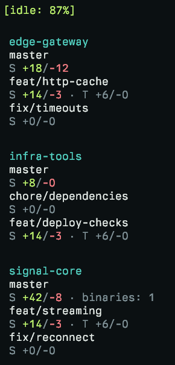

# Worktree Monitor

An always-on-top Windows dashboard showing branches and changed lines across Git repositories and their worktrees. Updates automatically without taking focus from your editor.



## Install

### Windows download

Download the Windows x64 ZIP from [Releases](https://github.com/konmik/worktree-monitor/releases), extract it, and run `wtm-gui.exe`. [Git](https://git-scm.com/downloads) must be on your `PATH`. Add the extracted folder to your `PATH` to use `wtm` and `wtm-tui` from a terminal.

### Build from source

Requires Windows x64, [Git](https://git-scm.com/downloads), stable [Rust](https://www.rust-lang.org/tools/install) with the MSVC toolchain, and [Visual Studio Build Tools](https://learn.microsoft.com/en-us/windows/dev-environment/rust/setup) with **Desktop development with C++** and a Windows SDK. The layout dependency compiles C++ code.

Clone the repository, then install all three executables:

```powershell
git clone https://github.com/konmik/worktree-monitor.git
cd worktree-monitor
cargo install --path crates/wtm --locked --bins
```

## Use

Register a repository, then open the dashboard:

```powershell
wtm add C:\src\project
wtm-gui
```

All worktrees of a registered repository are included. The dashboard also includes the repository you launch it from.

Run `wtm-tui` to show the live render buffer in your current terminal. Scroll with Up, Down, Page Up, Page Down, Home, and End. Press `q`, Escape, or Ctrl+C to exit.

Stop monitoring a repository:

```powershell
wtm remove C:\src\project
```

## GUI controls

- Drag repository headers or worktree cards to reorder them.
- Use **Hide**, **Show all**, and **Unhide** to control which worktrees appear.
- Drag empty space to move the window; drag its edges to resize it.
- Right-click the window or notification-area icon for opacity, visibility, reset position, and exit controls.

Window settings are remembered. Hover makes the window fully opaque.

## Counts

`S` means source, `T` tests, and `X` scripts and tooling. Each shows added and deleted lines. Binary files are counted separately.

Counts include branch commits, staged and unstaged changes, and untracked files, excluding ignored files. The comparison starts at the common ancestor with the local `main` branch, or `master` if `main` is absent. If neither provides a common ancestor, it compares with `HEAD`.

Changes inside Git-ignored folders do not trigger scans. Tracked files and changes to ignore rules are still monitored.

## Development

Monitoring and shared dashboard presentation are separate from the terminal and Windows clients. See the [architecture](docs/design.md).

Run the Rust tests and lint checks:

```powershell
cargo test --workspace --locked
cargo clippy --workspace --all-targets --locked -- -D warnings
```

Desktop smoke checks require PowerShell 7 and an interactive Windows desktop. See [testing and releases](docs/development.md).

## License

[MIT](LICENSE). Release ZIPs include dependency licenses and notices.
